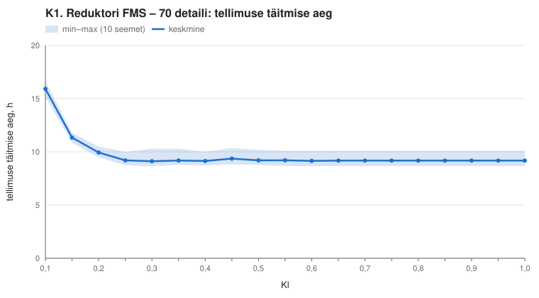
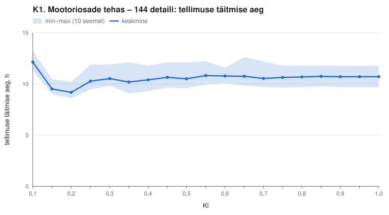
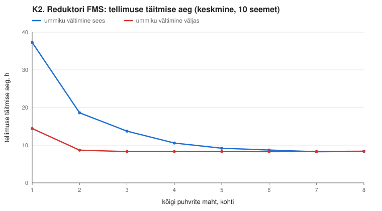
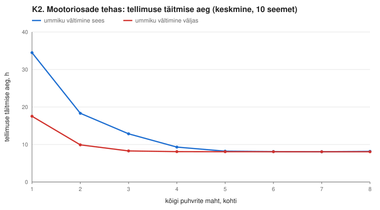

# Katsed tarkvaraga 1.5

Simulaatori tegelik mõte on aru saada, mis tootmissüsteemis mida mõjutab. Siin on näidismudelitega tehtud katsed: mudeli koopias muudetakse üht parameetrit ja vaadatakse, kuidas muutuvad tulemused.

- **Tarkvara**: versioon 1.5 (tag `v1.5`), `core/fms_glb.js` ja `core/fms_sim.js`. Koodi ei muudetud; katsed ei ole arendus.
- **Jooksutamine**: Node'is nagu VALIDEERIMINE.md etappides 11c ja 12b – mudeli koopia → parameetri muudatus → `CheckModel`, `Enumerate`, `SimRun`. Katseskriptid ei ole repos.
- **Juhuslikkus**: iga variant 10 seemnega (1–10). Tulemus on keskmine ja vahemik (min–max). Seemne 1 jooksud kontrollivad invariante igal sekundil.
- **Vead**: kui katse leiab tarkvarast vea, saab see numbri `PLAAN_TOOD_V2.md` osas 8 (T-n) ja siin on ainult viide.

| Katse | Küsimus | Seis |
|---|---|---|
| K1 | `Kl` (detaile süsteemis) ↔ tellimuse täitmise aeg, tsükliaeg | tehtud 2026-11-18 |
| K2 | puhvrite maht × ummiku vältimine sees / väljas ↔ tellimuse täitmise aeg | tehtud 2026-11-18 |

---

## K1. Detaile süsteemis (`Kl`) ja tellimuse täitmise aeg

### Küsimus ja hüpotees

Planner toob uue detaili süsteemi, kui `Ndet / (Ntm + Nmt + Nbuf + Ncon) < Kl` (DISAIN.md 5.2). `Kl` määrab seega, mitu detaili on korraga süsteemis.

Hüpotees (Little'i seadus `WIP = TH × CT` ja „kriitiline WIP“):
- Kuni kitsaskoha küllastumiseni lüheneb tellimuse täitmise aeg `Kl` kasvades kiiresti.
- Pärast seda läbilaskevõime enam ei kasva. Lisadetailid ainult ootavad ja tsükliaeg kasvab lineaarselt.
- Väga suure `Kl` juures võivad tulla parkimised või ummikud.

### Seaded

| | |
|---|---|
| Mudelid | Näidis-PTS (`demo`, 2 pinki, konveier), Reduktori FMS (`reduktor`, 12 pinki, 4 AGV-d, rikked), Mootoriosade tehas (`mootor`, 32 pinki, 3 konveierit + AGV-ring, 11 konnektorit, rikked) |
| Tellimus | lõpurežiim **Partiid lõpuni** (`Order`), tüüpide järjekord **Segamini**. Igast tüübist võrdselt: Näidis-PTS 40 tk (kokku 80), Reduktori FMS 10 tk (70), Mootoriosade tehas 9 tk (144). Praak asendatakse. |
| Mõõdik | **tellimuse täitmise aeg** (makespan) – esimese detaili sissetoomisest viimase valmimiseni, tundides |
| Muudetav | `Kl` 0,10…1,00, samm 0,05 (19 väärtust) × seemned 1–10 = 190 jooksu mudeli kohta, kokku 570 |
| Muu | mudeli ülejäänud seaded nagu näidises; ülempiir `Duration` 7 päeva (ühelgi jooksul ei saabunud) |

Kohtade arv `P = Ntm + Nmt + Nbuf + Ncon` on Näidis-PTS-is 14, Reduktori FMS-is 60 ja Mootoriosade tehases 162. Süsteemis on korraga kuni ⌈`Kl` · P⌉ detaili (tabelis veerg „detaile kuni“). Väikeses mudelis annavad kaks kõrvuti `Kl`-i sama arvu, seepärast on osa ridu samad.

### Tulemused

Graafikul (kaust `katsed/`, SVG) on sinine joon 10 seemne keskmine ja helesinine ala vahemik (väikseim–suurim). Horisontaalteljel on `Kl`, vertikaalteljel tellimuse täitmise aeg tundides.

Kõik 570 jooksu täitsid tellimuse. Ummikuid ega parkimisi ei olnud, invariandid (seeme 1) olid korras.

#### Näidis-PTS (80 detaili)

| Kl | detaile kuni | täitmise aeg, h: keskm. (min–max) | läbilaskevõime, tk/h | detaile keskm. | tsükliaeg, min | ootamine | suurim rakendatus |
|---|---|---|---|---|---|---|---|
| 0,10 | 2 | **9,63** (9,57–9,68) | 8,31 | 2,0 | 14 | 4 % | 70 % |
| 0,15 | 3 | **7,75** (7,65–7,84) | 10,32 | 3,0 | 17 | 19 % | 96 % |
| 0,20 | 3 | **7,75** (7,65–7,84) | 10,32 | 3,0 | 17 | 19 % | 96 % |
| 0,25 | 4 | **7,75** (7,68–7,83) | 10,33 | 3,9 | 23 | 40 % | 99 % |
| 0,30 | 5 | **7,81** (7,73–7,88) | 10,25 | 4,9 | 28 | 51 % | 99 % |
| 0,35 | 5 | **7,81** (7,73–7,88) | 10,25 | 4,9 | 28 | 51 % | 99 % |
| 0,40 | 6 | **7,80** (7,69–7,87) | 10,25 | 5,8 | 34 | 58 % | 99 % |
| 0,45 | 7 | **7,86** (7,78–7,92) | 10,18 | 6,6 | 39 | 64 % | 99 % |
| 0,50 | 7 | **7,86** (7,78–7,92) | 10,18 | 6,6 | 39 | 64 % | 99 % |
| 0,55 | 8 | **7,87** (7,68–7,98) | 10,16 | 7,5 | 44 | 68 % | 99 % |
| 0,60 | 9 | **7,87** (7,73–8,00) | 10,16 | 8,4 | 49 | 71 % | 99 % |
| 0,65 | 10 | **7,93** (7,81–8,01) | 10,09 | 9,2 | 55 | 74 % | 99 % |
| 0,70 | 10 | **7,93** (7,81–8,01) | 10,09 | 9,2 | 55 | 74 % | 99 % |
| 0,75 | 11 | **7,95** (7,85–8,05) | 10,06 | 10,0 | 60 | 76 % | 99 % |
| 0,80 | 12 | **7,94** (7,81–8,06) | 10,08 | 10,8 | 64 | 78 % | 99 % |
| 0,85 | 12 | **7,94** (7,81–8,06) | 10,08 | 10,8 | 64 | 78 % | 99 % |
| 0,90 | 13 | **8,00** (7,83–8,10) | 10,00 | 11,6 | 70 | 80 % | 99 % |
| 0,95 | 14 | **8,02** (7,85–8,14) | 9,97 | 12,4 | 74 | 81 % | 99 % |
| 1,00 | 14 | **8,02** (7,85–8,14) | 9,97 | 12,4 | 74 | 81 % | 99 % |

Praaki kokku (10 seemet × 19 Kl-i): 0.

#### Reduktori FMS (70 detaili)

| Kl | detaile kuni | täitmise aeg, h: keskm. (min–max) | läbilaskevõime, tk/h | detaile keskm. | tsükliaeg, min | ootamine | suurim rakendatus |
|---|---|---|---|---|---|---|---|
| 0,10 | 6 | **15,92** (15,18–16,64) | 4,40 | 5,7 | 76 | 12 % | 52 % |
| 0,15 | 9 | **11,34** (10,86–11,80) | 6,18 | 8,4 | 80 | 16 % | 70 % |
| 0,20 | 12 | **9,94** (9,48–10,49) | 7,05 | 10,9 | 91 | 25 % | 73 % |
| 0,25 | 15 | **9,20** (8,73–9,99) | 7,62 | 13,4 | 104 | 34 % | 79 % |
| 0,30 | 18 | **9,12** (8,65–10,30) | 7,70 | 15,4 | 118 | 43 % | 80 % |
| 0,35 | 21 | **9,18** (8,78–10,29) | 7,64 | 17,4 | 135 | 50 % | 77 % |
| 0,40 | 24 | **9,14** (8,70–10,01) | 7,67 | 19,5 | 151 | 55 % | 76 % |
| 0,45 | 27 | **9,36** (8,82–10,35) | 7,49 | 21,1 | 167 | 60 % | 74 % |
| 0,50 | 30 | **9,20** (8,78–10,19) | 7,62 | 23,4 | 181 | 63 % | 76 % |
| 0,55 | 33 | **9,20** (8,66–10,11) | 7,62 | 24,9 | 193 | 65 % | 76 % |
| 0,60 | 36 | **9,15** (8,66–10,11) | 7,67 | 26,6 | 205 | 67 % | 76 % |
| 0,65 | 39 | **9,18** (8,66–10,11) | 7,64 | 28,0 | 217 | 69 % | 76 % |
| 0,70 | 42 | **9,18** (8,66–10,11) | 7,64 | 29,4 | 228 | 70 % | 76 % |
| 0,75 | 45 | **9,18** (8,66–10,11) | 7,64 | 30,7 | 238 | 72 % | 76 % |
| 0,80 | 48 | **9,18** (8,66–10,11) | 7,64 | 31,9 | 247 | 73 % | 76 % |
| 0,85 | 51 | **9,18** (8,66–10,11) | 7,64 | 32,9 | 256 | 74 % | 76 % |
| 0,90 | 54 | **9,18** (8,66–10,11) | 7,64 | 33,9 | 263 | 74 % | 76 % |
| 0,95 | 57 | **9,18** (8,66–10,11) | 7,64 | 34,8 | 270 | 75 % | 76 % |
| 1,00 | 60 | **9,18** (8,66–10,11) | 7,64 | 35,6 | 276 | 76 % | 76 % |

Praaki kokku (10 seemet × 19 Kl-i): 196.

#### Mootoriosade tehas (144 detaili)

| Kl | detaile kuni | täitmise aeg, h: keskm. (min–max) | läbilaskevõime, tk/h | detaile keskm. | tsükliaeg, min | ootamine | suurim rakendatus |
|---|---|---|---|---|---|---|---|
| 0,10 | 17 | **12,14** (11,30–13,23) | 11,89 | 15,2 | 75 | 13 % | 52 % |
| 0,15 | 25 | **9,51** (9,01–10,46) | 15,17 | 21,5 | 84 | 18 % | 58 % |
| 0,20 | 33 | **9,18** (8,60–10,21) | 15,75 | 26,3 | 99 | 30 % | 57 % |
| 0,25 | 41 | **10,27** (9,46–11,89) | 14,09 | 29,2 | 122 | 43 % | 49 % |
| 0,30 | 49 | **10,52** (9,83–11,91) | 13,73 | 33,5 | 144 | 52 % | 49 % |
| 0,35 | 57 | **10,19** (9,07–12,12) | 14,24 | 39,7 | 165 | 58 % | 51 % |
| 0,40 | 65 | **10,40** (9,31–11,80) | 13,91 | 43,5 | 184 | 63 % | 50 % |
| 0,45 | 73 | **10,65** (9,65–12,10) | 13,59 | 46,5 | 202 | 66 % | 48 % |
| 0,50 | 81 | **10,50** (9,59–12,10) | 13,77 | 50,5 | 217 | 68 % | 51 % |
| 0,55 | 90 | **10,82** (9,95–12,22) | 13,38 | 53,3 | 235 | 71 % | 50 % |
| 0,60 | 98 | **10,78** (10,07–11,59) | 13,39 | 56,3 | 248 | 73 % | 50 % |
| 0,65 | 106 | **10,75** (9,83–12,61) | 13,46 | 58,7 | 257 | 73 % | 50 % |
| 0,70 | 114 | **10,53** (9,72–12,20) | 13,73 | 61,9 | 266 | 74 % | 51 % |
| 0,75 | 122 | **10,64** (9,64–11,78) | 13,58 | 63,4 | 275 | 75 % | 52 % |
| 0,80 | 130 | **10,69** (9,69–11,78) | 13,51 | 64,9 | 283 | 76 % | 51 % |
| 0,85 | 138 | **10,74** (9,76–11,78) | 13,44 | 65,8 | 289 | 76 % | 51 % |
| 0,90 | kõik | **10,71** (9,69–11,78) | 13,48 | 66,7 | 292 | 77 % | 51 % |
| 0,95 | kõik | **10,71** (9,69–11,78) | 13,48 | 66,7 | 292 | 77 % | 51 % |
| 1,00 | kõik | **10,71** (9,69–11,78) | 13,48 | 66,7 | 292 | 77 % | 51 % |

Praaki kokku (10 seemet × 19 Kl-i): 526.

### Little'i seadus

Tellimuse režiimis on kõik detailid lõpuks valmis, seega peab kehtima `AvgWip = (valmis / makespan) × AvgCycleTime` ehk suhe on 1.
- **279 praagita jooksus** on suhe 0,9999–1,0000.
- **291 praagiga jooksus** on suhe 1,002–1,065. Põhjus: `AvgWip` arvestab ka praagiks läinud detaile, aga `AvgCycleTime` ainult valmis detaile.

Statistika on seega kooskõlas ja tarkvara viga ei ole.

### Näidis-PTS – kriitiline WIP

- Kitsaskoht on MT2 (rakendatus 96–99 %), küllastunud läbilaskevõime `rb` ≈ 10,3 tk/h.
- Puhas tööaeg `T0` ≈ 13,8 min. See on 2 detailiga jooksu tsükliaeg 14,4 min miinus ootamine 4 %, seega mõõdetud, mitte käsitsi arvutatud.
- Kriitiline WIP `W0 = rb × T0` ≈ 10,3 × 13,8 / 60 ≈ **2,4 detaili**.

Parim võimalik läbilaskevõime on `min(w / T0, rb)`:

| detaile w | ootus | simulatsioon |
|---|---|---|
| 2 | 8,7 tk/h | 8,3 |
| 3 | 10,3 tk/h (küllastus) | 10,3 |

Murdepunkt on 2 ja 3 detaili vahel, nagu teooria ütleb.

### Järeldused

1. **Hüpotees kehtib Näidis-PTS-is ja Reduktori FMS-is.**
   - Näidis-PTS: täitmise aeg langeb 9,6 → 7,75 h, kui `Kl` = 0,15 (3 detaili), ja püsib siis 7,75–8,0 h juures.
   - Reduktori FMS: täitmise aeg langeb 15,9 → 9,1 h, kui `Kl` ≈ 0,3 (keskmiselt 15 detaili), ja püsib siis 9,1–9,4 h juures.
   - Pärast murdepunkti kasvab tsükliaeg lineaarselt: Näidis-PTS 17 → 74 min, Reduktori FMS 91 → 276 min. Kasvab ka ootamise osa, kuni ~80 %-ni. Läbilaskevõime ei kasva.
2. **Liiga suur `Kl` ei kiirenda, aga teeb tsükliaja pikaks.**
   - Näidis-PTS-i näidise seade `Kl` 0,85: täitmise aeg sama mis 0,15 juures (+2,5 %), tsükliaeg 64 min (0,15 juures 17 min).
   - Reduktori FMS-i seade 0,4: 0,3 annab sama täitmise aja ja 21 % lühema tsükliaja.
3. **Mootoriosade tehases on parim `Kl` 0,2** (9,2 h, näidise oma seade 12b-st). Suurem `Kl` teeb tellimuse täitmise **aeglasemaks** (0,25…1,0: 10,2–10,8 h, +11–18 %).
   - Mõõdetud (seeme 1): kui `Kl` on 0,6, ootab FromCS-is sihtkohta keskmiselt 21,9 detaili (0,2 juures 1,0). Pinkide puhvrites ootab 16,6 detaili (0,2 juures 5,0).
   - Täitmise aja lõpu määrab mõlemal juhul praagi asendus: viimane Plokikaas tuuakse sisse 7,7 h / 8,3 h ja tema marsruut kestab ~2,5 h.
   - Miks just suur `Kl` on aeglasem, on **kontrollimata**. Hüpotees: kui palju detaile ootab sissepääsu juures, ei vabastata neid enam Planneri „Segamini“ järjekorras, vaid selles järjekorras, kes saab esimesena sihtkoha.
4. **Seemnete hajuvus kasvab koos rikete mõjuga.**

   | mudel | vahemik | seemnete vahe |
   |---|---|---|
   | Näidis-PTS (rikkeid pole) | 0,2–0,3 h | ±2 % |
   | Reduktori FMS | ~1,5 h | ±8 % |
   | Mootoriosade tehas | kuni 3 h | ±15 % |

   Mootoriosade tehases on aeglasemad need seemned, kus on rohkem praaki. Näiteks `Kl` 0,2 juures: seemnel 8 oli 7 praaki ja täitmise aeg 9,9 h, seemnel 4 0 praaki ja 8,7 h. Praak asendatakse tellimuse lõpus ja asendus läbib kogu marsruudi.
5. **Kui `Kl` kasvab üle murdepunkti, ootavad lisadetailid sissepääsu juures.** `Kl` loeb süsteemi kõik sisse toodud detailid, ka FromCS-is sihtkohta ootavad (DISAIN.md 5.2). Detail läheb teele alles siis, kui sihtkoht on broneeritud (5.2 p 3).
   - Seepärast on tsükliajas ka ootamine sissepääsu juures (`TimeIn` = sissetoomine).
   - Reduktori FMS-is on tulemus alates `Kl` 0,6 kõigi seemnetega täpselt sama, ainult maksimaalne detailide arv kasvab: lisadetailid ainult ootavad järjekorras.
   - See on mudeli loogika, mitte viga, aga tulemuste lugemisel on see oluline.

**Tarkvara vigu K1 ei leidnud.**

### Mida see EI kontrolli

- Läbilaskevõimet Kellani-režiimis (püsiseisus): ainult tellimus, kus täitmise aja sees on käivitus ja lõpp.
- Tüüpide järjekorda Partii järjest, teisi näidismudeleid ega `Kl` väärtusi alla 0,1.
- Mootoriosade tehase suurema `Kl` aeglustumise põhjust (järeldus 3) ja seda, kui palju määrab täitmise aja praagi asendus. Selleks oleks vaja suuremat tellimust või Kellani-režiimi.

### Edasi (katsete ideed, mitte arendus)

- K1b: Mootoriosade tehas suurema tellimusega (nt 30 tk tüübist) ja Kellani-režiimis 24 h, et lahutada lõpu mõju (järeldus 3).
- K3–K5 (ettepanek 2026-11-18): transport (kärud, alused, kiirus, konnektorid); partii suurus ja tüüpide järjekord; rikete muster ja seemnete arv.

---

## K2. Puhvrite maht ja ummiku vältimise hind

### Küsimus ja hüpotees

Ummiku vältimine (`Sim.ReserveNextBeforeStart`, vaikimisi sees, DISAIN.md 3.3) tähendab, et pink alustab detailiga alles siis, kui detaili järgmise pingi puhvris on koht broneeritud. Broneering hoiab kohta kinni kogu töötlemise aja (VALIDEERIMINE.md 11c leid 4).

Hüpotees:
- Kui vältimine on sees, aeglustavad väikesed puhvrid tööd.
- Kui see on väljas, tuleb väikeste puhvritega ummikuid ja parkimisi. Suurte puhvritega on tulemus sama või parem.

### Seaded

| | |
|---|---|
| Mudelid | Näidis-PTS, Reduktori FMS, Allhanketehas, Mootoriosade tehas. Lisaks **Näidis-PTS ristmarsruudiga**: mudeli koopias on Ääriku marsruut freesimine 200 ± 30 s (MT2) → treimine 120 ± 10 s (MT1), nii et Võll läheb MT1 → MT2 ja Äärik MT2 → MT1. |
| Tellimus | nagu K1: Partiid lõpuni, Segamini. Näidis-PTS 40 tk tüübist (80), Reduktori FMS 10 (70), Allhanketehas 4 (48), Mootoriosade tehas 9 (144). |
| Muudetav | **kõigi puhvrite maht** 1…8 × ummiku vältimine **sees / väljas** × seemned 1–10 = 160 jooksu mudeli kohta, kokku 800 |
| Detaile süsteemis | sama mis näidises (Näidis-PTS 12, Reduktori FMS 24, Allhanketehas 23, Mootoriosade tehas 33). Puhvri maht muudab kohtade arvu P, seepärast arvutatakse `Kl` = (W − 0,5) / P ümber, et piir ⌈`Kl` · P⌉ jääks samaks. Nii mõõdetakse puhvri mõju, mitte detailide arvu mõju (K1). |
| Mõõdik | tellimuse täitmise aeg, tsükliaeg, parkimised (ajutine viimine kesklattu), lahendamatud ummikud |

### Tulemused

Graafikul on **sinine** joon „vältimine sees“ ja **punane** joon „vältimine väljas“ (10 seemne keskmine). Graafikud on kaustas `katsed/` (SVG). Horisontaalteljel on puhvri maht, vertikaalteljel tellimuse täitmise aeg tundides. Invariandid (seeme 1) olid kõigis jooksudes korras.

#### Näidis-PTS (80 detaili, 12 süsteemis)

| maht | kohti P | `Kl` | vältimine sees: aeg, h | tsükliaeg, min | parkimisi | vältimine väljas: aeg, h | tsükliaeg, min | parkimisi |
|---|---|---|---|---|---|---|---|---|
| 1 | 10 | 1,150 | **11,81** (11,74–11,86) | 97 | 0 | **11,25** (11,20–11,31) | 93 | 0 |
| 2 | 12 | 0,958 | **8,41** (8,25–8,56) | 69 | 0 | **7,79** (7,62–8,06) | 66 | 0 |
| 3 | 14 | 0,821 | **7,94** (7,81–8,06) | 64 | 0 | **7,81** (7,67–7,89) | 67 | 0 |
| 4 | 16 | 0,719 | **7,90** (7,81–7,98) | 64 | 0 | **7,81** (7,73–7,92) | 65 | 0 |
| 5 | 18 | 0,639 | **7,85** (7,78–7,93) | 64 | 0 | **7,63** (7,53–7,73) | 63 | 0 |
| 6 | 20 | 0,575 | **7,93** (7,82–8,05) | 65 | 0 | **7,67** (7,59–7,72) | 63 | 0 |
| 7 | 22 | 0,523 | **7,90** (7,79–8,07) | 65 | 0 | **7,67** (7,58–7,77) | 63 | 0 |
| 8 | 24 | 0,479 | **7,85** (7,81–7,94) | 64 | 0 | **7,67** (7,58–7,76) | 63 | 0 |

#### Reduktori FMS (70 detaili, 24 süsteemis)

| maht | kohti P | `Kl` | vältimine sees: aeg, h | tsükliaeg, min | parkimisi | vältimine väljas: aeg, h | tsükliaeg, min | parkimisi |
|---|---|---|---|---|---|---|---|---|
| 1 | 28 | 0,839 | **37,28** (36,52–38,99) | 649 | 0 | **14,42** (13,70–15,67) | 241 | 0 |
| 2 | 40 | 0,588 | **18,60** (17,76–19,45) | 321 | 0 | **8,68** (8,15–9,95) | 145 | 0 |
| 3 | 52 | 0,452 | **13,73** (12,77–15,15) | 224 | 0 | **8,30** (7,75–9,25) | 136 | 0 |
| 4 | 64 | 0,367 | **10,57** (10,09–11,26) | 176 | 0 | **8,31** (7,80–9,31) | 135 | 0 |
| 5 | 76 | 0,309 | **9,20** (8,56–10,34) | 152 | 0 | **8,32** (7,80–9,08) | 136 | 0 |
| 6 | 88 | 0,267 | **8,72** (8,34–9,81) | 141 | 0 | **8,28** (7,81–9,02) | 136 | 0 |
| 7 | 100 | 0,235 | **8,27** (7,71–9,10) | 136 | 0 | **8,33** (7,71–9,26) | 136 | 0 |
| 8 | 112 | 0,210 | **8,35** (7,88–9,25) | 136 | 0 | **8,39** (7,89–9,41) | 136 | 0 |

#### Allhanketehas (48 detaili, 23 süsteemis)

| maht | kohti P | `Kl` | vältimine sees: aeg, h | tsükliaeg, min | parkimisi | vältimine väljas: aeg, h | tsükliaeg, min | parkimisi |
|---|---|---|---|---|---|---|---|---|
| 1 | 46 | 0,489 | **15,75** (15,07–15,88) | 318 | 0 | **7,01** (6,80–7,41) | 154 | 0 |
| 2 | 61 | 0,369 | **7,82** (7,30–8,33) | 157 | 0 | **4,48** (4,35–4,81) | 98 | 0 |
| 3 | 76 | 0,296 | **6,31** (5,68–6,77) | 119 | 0 | **4,45** (4,25–4,76) | 94 | 0 |
| 4 | 91 | 0,247 | **5,17** (4,78–5,97) | 104 | 0 | **4,47** (4,26–4,83) | 96 | 0 |
| 5 | 106 | 0,212 | **4,81** (4,52–5,24) | 99 | 0 | **4,57** (4,32–4,95) | 96 | 0 |
| 6 | 121 | 0,186 | **4,57** (4,26–4,88) | 97 | 0 | **4,57** (4,32–4,95) | 96 | 0 |
| 7 | 136 | 0,165 | **4,52** (4,35–4,96) | 98 | 0 | **4,57** (4,32–4,95) | 96 | 0 |
| 8 | 151 | 0,149 | **4,53** (4,35–4,96) | 98 | 0 | **4,57** (4,32–4,95) | 96 | 0 |

#### Mootoriosade tehas (144 detaili, 33 süsteemis)

| maht | kohti P | `Kl` | vältimine sees: aeg, h | tsükliaeg, min | parkimisi | vältimine väljas: aeg, h | tsükliaeg, min | parkimisi |
|---|---|---|---|---|---|---|---|---|
| 1 | 111 | 0,293 | **34,49** (32,41–39,05) | 330 | 0 | **17,53** (17,17–17,74) | 195 | 0 |
| 2 | 143 | 0,227 | **18,33** (17,11–20,66) | 174 | 0 | **9,91** (9,69–10,31) | 114 | 0 |
| 3 | 175 | 0,186 | **12,85** (12,19–14,13) | 123 | 0 | **8,29** (7,54–9,36) | 93 | 0 |
| 4 | 207 | 0,157 | **9,31** (8,71–10,71) | 99 | 0 | **8,10** (7,61–8,85) | 91 | 0 |
| 5 | 239 | 0,136 | **8,22** (7,68–9,32) | 92 | 0 | **8,08** (7,47–9,29) | 90 | 0 |
| 6 | 271 | 0,120 | **8,11** (7,44–9,04) | 91 | 0 | **8,07** (7,50–9,07) | 90 | 0 |
| 7 | 303 | 0,107 | **8,08** (7,49–9,21) | 91 | 0 | **8,07** (7,50–9,07) | 90 | 0 |
| 8 | 335 | 0,097 | **8,16** (7,62–9,21) | 91 | 0 | **8,07** (7,50–9,07) | 90 | 0 |

#### Näidis-PTS ristmarsruudiga (80 detaili, 12 süsteemis)

Rist (×) näitab mahtu, kus vähemalt üks seeme jäi lõplikult ummikusse; seal joont ei ole.

| maht | kohti P | `Kl` | vältimine sees: aeg, h | tsükliaeg, min | parkimisi | vältimine väljas: aeg, h | tsükliaeg, min | parkimisi |
|---|---|---|---|---|---|---|---|---|
| 1 | 10 | 1,150 | **14,51** (14,41–14,63) | 119 | 10 | ummik 10/10 | 128 | 260 |
| 2 | 12 | 0,958 | **8,58** (8,40–8,80) | 72 | 10 | ummik 10/10 | 106 | 248 |
| 3 | 14 | 0,821 | **6,82** (6,70–6,93) | 58 | 10 | ummik 10/10 | 85 | 140 |
| 4 | 16 | 0,719 | **6,81** (6,70–6,91) | 59 | 10 | **6,93** (6,81–7,05), ummik 7/10 | 64 | 152 |
| 5 | 18 | 0,639 | **6,81** (6,69–6,90) | 59 | 10 | **5,83** (5,53–6,13) | 50 | 55 |
| 6 | 20 | 0,575 | **6,80** (6,68–6,90) | 59 | 10 | **5,36** (5,28–5,44) | 46 | 10 |
| 7 | 22 | 0,523 | **5,27** (5,21–5,35) | 45 | 0 | **5,24** (5,20–5,29) | 45 | 0 |
| 8 | 24 | 0,479 | **5,24** (5,20–5,29) | 45 | 0 | **5,24** (5,20–5,29) | 45 | 0 |

### Miks näidismudelites ummikut ei teki

Kõigis 7 näidismudelis on pinkide järjekord marsruutides **ühesuunaline**. Kontrollisin seda graafina: serv pingist A pinki B, kui mõni marsruut läheb A-st B-sse; tsükleid ei ole. Ükski tüüp ei lähe B-st tagasi A-sse.

Ringootamiseks on vaja tsüklit. Ilma tsüklita jõuab ootamisahel alati pingini, mis saab detaili edasi anda: viimased pingid saadavad detaili kesklattu, mis ei saa täis. Seepärast ei tekkinud nelja näidise 640 jooksus ühtegi ummikut ega parkimist, ka mitte siis, kui vältimine oli väljas.

### Järeldused

1. **Ühesuunalise vooga mudelites on ummiku vältimine puhas kulu.** Ilma vältimiseta on tellimus väikeste puhvritega mitu korda kiiremini täidetud (maht 2):

   | mudel | vältimine sees | väljas |
   |---|---|---|
   | Reduktori FMS | 18,6 h | 8,7 h |
   | Allhanketehas | 7,8 h | 4,5 h |
   | Mootoriosade tehas | 18,3 h | 9,9 h |

   Vältimine sees vajab sama tulemuse jaoks palju suuremaid puhvreid: Reduktori FMS 7, Allhanketehas 6, Mootoriosade tehas 5. Ilma vältimiseta piisab 2–3 kohast. Põhjus: broneeritud koht järgmise pingi puhvris on kinni kogu töötlemise aja, kuigi on füüsiliselt tühi (11c leid 4).
2. **Ristmarsruudiga on vältimine vajalik.**
   - Vältimine väljas: puhvri mahuga 1–3 jäi süsteem kõigi seemnetega lõplikult ummikusse. Kesklattu pargiti, kuni see oli täis, ja tellimus jäi pooleli. Mahuga 4 juhtus sama 7 seemnega 10-st, mahuga 5 pargiti 55 korda (10 jooksus).
   - Vältimine sees: lahendamatut ummikut ei olnud ühelgi mahul. Mahuga 1–6 pargiti igas jooksus täpselt üks detail, käivitusel (seeme 1: t = 716 s).
   - See kinnitab varasemat valideerimist (VALIDEERIMINE.md etapp 2 leid 3).
3. **Ristmarsruudi korral on puhvri mahul selge lävi.**
   - Kui kahe puhvri kohti on kokku vähem või sama palju kui detaile süsteemis (maht ≤ 6: kuni 12 kohta, 12 detaili), saavad puhvrid täis. Pingid ootavad vaheldumisi teineteise broneeringut: mahuga 3–6 on täitmise aeg 6,8 h ja rakendatus 75 % (mahuga 1–2 veel aeglasem).
   - Mahuga 7 (14 kohta > 12 detaili) on täitmise aeg 5,2 h ja rakendatus 97–98 %. Siis on vältimisega ja ilma sama tulemus.
   - Mahuga 5–6 on ilma vältimiseta kiirem (5,8 ja 5,4 h), aga ainult parkimise abil: kesklaos peab olema ruumi.
   - Kokkuvõttes: **ristmarsruudiga peab puhvrikohti olema rohkem kui detaile süsteemis**, siis ei maksa vältimine midagi.
4. **Kui puhvreid on piisavalt, ei anna nende suurendamine enam midagi** (nagu 12b leid 3). Tõuseb ainult `Kl` järgi süsteemi lubatud detailide arv. Siin hoiti see konstantsena (K1 näitas, mida see teeb).
5. **Näidiste segamahud on head.** Reduktori FMS-i oma puhvrid (8 × 3, ühistel pinkidel 4 × 5, K1-s `Kl` 0,4) annavad 9,1 h. Ühtlane maht 3 annab vältimisega 13,7 h ja ühtlane 4 annab 10,6 h. Suured puhvrid ühiste pinkide ees on kasulikumad kui ühtlane suurendamine.

**Tarkvara vigu K2 ei leidnud.**

Seadet `ReserveNextBeforeStart` liideses ei ole (ainult mudelifailis `Sim`-is). Tarkvaras 1.5 on vältimine kasutaja jaoks seega alati sees.

### Mida see EI kontrolli

- Puhvri mahtu ainult ühiste pinkide ees (siin muudeti kõiki puhvreid korraga).
- Puhvri distsipliini (FIFO / FILO / RANDOM).
- Teisi ristmarsruudiga mudeleid kui Näidis-PTS-i koopiat. Seal on tsükkel kahe pingi vahel; pikem tsükkel (A → B → C → A) võib käituda teisiti.
- Kellani-režiimi (püsiseisu läbilaskevõimet).

### Edasi (katsete ideed, mitte arendus)

- K2b: puhvri maht ainult ühiste (kitsaskoha) pinkide ees ja pikema tsükliga ristmarsruut.
